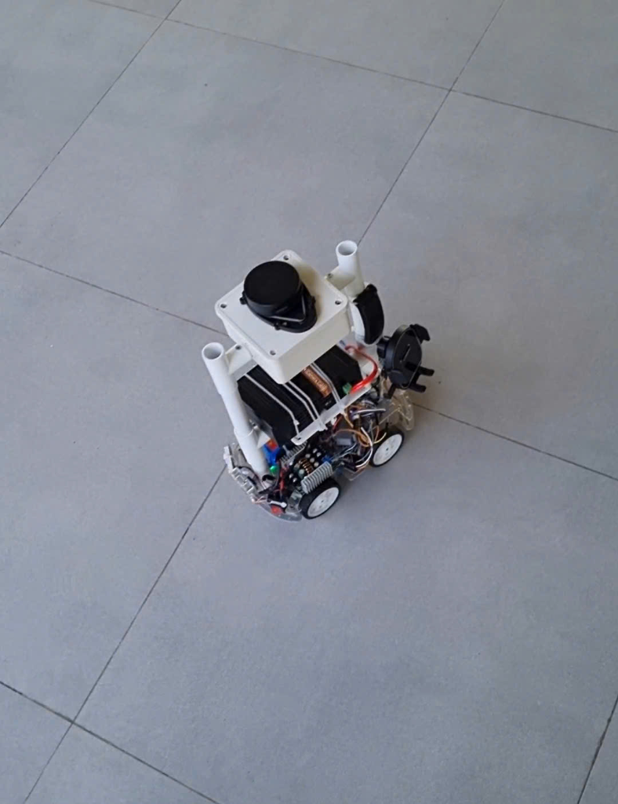
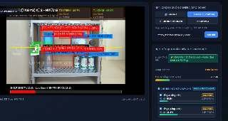

# SuperMarketBot (SMB) - Autonomous Retail AMR & Shelf Audit Platform

<div align="center">

[](https://docs.ros.org/en/rolling/)
[](https://ubuntu.com/)
[](https://www.docker.com/)
[](https://navigation.ros.org/)
[](https://www.raspberrypi.com/)
[](https://www.raspberrypi.com/documentation/accessories/ai-camera.html)
[](LICENSE)

**An autonomous differential-drive robot designed for retail environments, featuring 2D LiDAR SLAM, waypoint-based aisle patrol, on-device AI shelf inventory auditing, and cloud fleet synchronization.**

[Key Features](#-key-features) •
[Architecture](#-system-architecture) •
[Hardware Stack](#-hardware-stack) •
[Quickstart](#-quickstart) •
[AI Shelf Vision](#-ai-shelf-vision--inventory-audit) •
[Repository Layout](#-repository-layout) •
[API & Contracts](#-communication-contracts)

---

</div>

<div align="center">
  <table>
    <tr>
      <td align="center" width="50%">
        
        <br />
        <b>Figure 1:</b> <i>SuperMarketBot AMR Physical Chassis (Raspberry Pi 5 + YDLIDAR + Sony IMX500 AI Camera + ESP32-S3 base)</i>
      </td>
      <td align="center" width="50%">
        
        <br />
        <b>Figure 2:</b> <i>Real-time Shelf Auditing UI (ArUco Shelf Tagging, Layer Segmentation, and Out-of-Stock Detection)</i>
      </td>
    </tr>
  </table>
</div>

---

## 📌 Repository Description

> **GitHub Tagline:**
> *Autonomous retail inventory robot powered by ROS 2, Nav2, SLAM Toolbox, and Raspberry Pi AI Camera (IMX500). Features real-time shelf auditing, Out-of-Stock (OOS) detection, micro-ROS ESP32 bridge, and .NET MQTT integration.*

**Topics:** `ros2`, `nav2`, `robotics`, `slam-toolbox`, `raspberry-pi-5`, `imx500`, `computer-vision`, `shelf-monitoring`, `autonomous-mobile-robot`, `micro-ros`, `mqtt`, `docker`

---

## 🚀 Key Features

- **Autonomous Aisle Navigation:** Full Nav2 stack integration (Navfn planner, DWB local controller, costmap safety layers) tailored for narrow retail aisles.
- **2D LiDAR SLAM & Localization:** SLAM Toolbox online mapping and AMCL probabilistic localization with automatic heading corrections.
- **AI Shelf Vision & Out-of-Stock (OOS) Detection:** Edge vision processing powered by the Sony IMX500 sensor on Raspberry Pi 5. Automatically detects ArUco shelf markers, identifies shelf tiers, recognizes stock products, and flags empty shelf slots in real time.
- **Hybrid Real-Time Architecture:**
  - **ESP32-S3:** High-rate motor PWM control, quadrature wheel odometry calculation, and IMU acquisition via **micro-ROS**.
  - **Raspberry Pi 5:** Containerized ROS 2 navigation stack with host-level access to picamera2 for hardware-accelerated computer vision.
- **Fail-Safe Obstacle Avoidance:** Multi-tier safety combines LiDAR dynamic costmaps with a dedicated hardware ultrasonic guard node (`ultrasonic_guard.py`) providing an active emergency brake.
- **Enterprise Integration:** Bidirectional MQTT bridge (`smb_mqtt_bridge.py`) communicating with the .NET backend for automated mission scheduling, telemetry streaming, and remote mission aborts.
- **Headless Robot Agent Daemon:** Lightweight REST service on port `5000` (`robot_agent_server.py`) for one-touch Docker container management, mapping initiation, and map serialization.
- **Digital Twin Simulation:** High-fidelity Gazebo Sim environment with matched URDF physical dimensions, inertia, and sensor noise characteristics.

---

## 🏗 System Architecture

The robot connects embedded real-time control, edge computing, computer vision, and cloud orchestration:

```mermaid
flowchart TB
    subgraph CLOUD_BACKEND["Cloud & Store Management"]
        Backend[".NET Enterprise Backend / MQTT Broker"]
        WebUI["Web Operator Dashboard"]
    end

    subgraph PI5["Raspberry Pi 5 (Ubuntu Core / Host)"]
        AgentServer["Robot REST Agent Daemon\n(:5000)"]
        CamNode["Native IMX500 Vision Streamer\n(picamera2 + OpenCV)"]
        
        subgraph DOCKER["Docker Container (ROS 2 Lyrical Core)"]
            MicroAgent["micro-ROS Agent\n(/dev/ttyUSB0)"]
            LiDARNode["YDLIDAR Driver\n(/dev/ttyUSB1)"]
            RelayNode["Sensor Relay & TF Publisher"]
            SLAM["SLAM Toolbox / AMCL"]
            Nav2["Nav2 Stack (DWB / Navfn)"]
            Supervisor["SMB Supervisor FSM"]
            MQTTBridge["SMB MQTT Bridge"]
            UltraGuard["Ultrasonic Guard E-Stop"]
            Rosbridge["rosbridge_suite\n(WebSocket :9090)"]
        end
    end

    subgraph EMBEDDED["Embedded Hardware (ESP32-S3 Chassis)"]
        Motors["DC Motors + Wheel Encoders"]
        IMU["MPU6050 / BNO055 IMU"]
        Sonar["HC-SR04 Ultrasonic Sensors"]
    end

    %% Connections
    Backend <-->|MQTT: smartmarketbot/robot/{id}/...| MQTTBridge
    WebUI <-->|HTTP REST :5000| AgentServer
    CamNode <-->|WebSocket :9090| Rosbridge
    MicroAgent <-->|USB Serial 921600 baud| EMBEDDED
    LiDARNode -->|/scan| SLAM
    LiDARNode -->|/scan| Nav2
    RelayNode -->|/odom, /imu/data| SLAM
    RelayNode -->|/odom, /imu/data| Nav2
    Nav2 -->|/cmd_vel| RelayNode
    UltraGuard -.->|Emergency E-Stop /cmd_vel| RelayNode
    CamNode -->|/camera/image_raw, /shelf/analysis| Supervisor
    Supervisor -->|Status, OOS Metrics| MQTTBridge
```

---

## 🛠 Hardware Stack

| Component | Hardware Specification | Function |
|---|---|---|
| **Primary Compute** | **Raspberry Pi 5 (8GB RAM)** | Runs Dockerized ROS 2 stack, SLAM, Nav2, and AI camera processing |
| **Microcontroller** | **ESP32-S3 Dual-Core (micro-ROS)** | Real-time motor PID loops, encoder reading, IMU integration |
| **LiDAR Sensor** | **YDLIDAR 360° Laser Scanner** | Range 0.08m – 10.0m, 360 samples/rev for mapping & costmaps |
| **AI Vision Camera** | **Raspberry Pi AI Camera (Sony IMX500)** | Hardware NN inference, shelf edge detection, ArUco detection |
| **Inertial Measurement** | **6-DOF IMU (MPU6050 / BNO055)** | High-frequency angular velocity & linear acceleration |
| **Safety Sensors** | **Ultrasonic Rangefinders (HC-SR04)** | Close-range safety barrier & emergency stop guard |
| **Chassis & Drive** | **Differential Drive Chassis** | Dimensions: 0.30 m × 0.22 m × 0.13 m; Wheel diameter: 0.08 m |

---

## 📦 Repository Layout

```
SuperMarketBot-ROS2/
├── Dockerfile                     # Optimized ROS 2 container configuration
├── docker-compose.yml             # Privileged host-network Docker orchestration
├── entrypoint.sh                  # Container entrypoint and environment initialization
├── ros2_ws.repos                  # vcstool manifest for upstream dependencies
├── .colcon_defaults               # Build configurations and package flags
├── docs/                          # Architecture contracts and guides
│   ├── assets/                    # Robot photos, architecture diagrams, and UI assets
│   ├── TOPIC_CONTRACT.md          # Embedded ↔ ROS 2 interface specification
│   ├── backend_ros2_mqtt_contract.md # .NET backend ↔ ROS 2 MQTT contract
│   └── REAL_ROBOT_MAPPING_RECOVERY.md# Odometry calibration & mapping field guide
├── scripts/                       # Deployment, automation, and test tools
│   ├── start_pi5_robot.sh         # Production bringup script on Raspberry Pi 5
│   ├── deploy_to_pi.sh            # Remote deployment and code sync utility
│   ├── robot_agent_server.py      # Lightweight REST control server (:5000)
│   ├── native_imx500_stream.py    # Native Pi OS IMX500 camera streamer
│   ├── diagnose_mapping.sh        # 10-second non-intrusive sensor & TF diagnostic audit
│   ├── test_sim.sh                # Gazebo simulation launcher (GUI / Headless)
│   ├── test_robot.sh              # Local test bringup (micro-ROS + SLAM + RViz)
│   ├── test_teleop.sh             # Interactive keyboard teleoperation driver
│   ├── test_calibration.sh        # Wheel odometry & rotation calibration wizard
│   ├── test_odom_drift.sh         # Real-time odometry drift monitor
│   ├── test_nav2_goal.sh          # Navigation action test runner
│   ├── robot_agent.service        # Systemd unit for REST daemon
│   └── smb-camera.service         # Systemd unit for IMX500 camera daemon
└── src/
    ├── micro_ros_agent/           # micro-ROS communication agent
    ├── smb_ai_camera/             # AI shelf analysis, product matching & OOS detection
    ├── smb_bridge/                # Hardware & network communication bridges
    ├── smb_msgs/                  # Custom ROS 2 interfaces and message definitions
    ├── smb_nodes/                 # Supervisor, MQTT bridge, waypoint follower, relays
    ├── smb_robot/                 # Robot URDF, kinematics, materials, and geometry
    ├── smb_robot_bringup/         # Launch files, Nav2 configurations, maps, and worlds
    └── ydlidar_ros2_driver/       # Driver node for YDLIDAR laser scanner
```

---

## ⚡ Quickstart

### 1. Workstation Installation (Simulation & Development)

```bash
# Clone the repository
mkdir -p ~/ros2_ws/src && cd ~/ros2_ws
git clone https://github.com/SuperMarketBot-SU26/SuperMarketBot-ROS2.git .

# Import upstream dependencies (micro_ros_agent, slam_toolbox)
sudo apt update && sudo apt install -y python3-vcstool
vcs import src < ros2_ws.repos

# Install ROS 2 dependencies
sudo apt install -y \
  ros-${ROS_DISTRO}-nav2-bringup \
  ros-${ROS_DISTRO}-robot-state-publisher \
  ros-${ROS_DISTRO}-xacro \
  ros-${ROS_DISTRO}-ros-gz \
  ros-${ROS_DISTRO}-ros-gz-bridge

# Build workspace (parallel-workers 2 recommended on embedded machines)
source /opt/ros/${ROS_DISTRO}/setup.bash
colcon build --parallel-workers 2
source install/setup.bash
```

### 2. Running Simulation Mode

Launch the full digital twin with Gazebo Sim, SLAM Toolbox, and RViz:

```bash
# Full GUI mode (Gazebo 3D world + RViz2 visualization)
./scripts/test_sim.sh

# Headless mode (Server-only for remote workstations/CI)
./scripts/test_sim.sh true
```

### 3. Deploying to Real Robot (Raspberry Pi 5)

#### Option A: One-Command Production Bringup
```bash
# Starts micro-ROS agent, LiDAR, state publisher, SLAM/localization, and Nav2
./scripts/start_pi5_robot.sh
```

#### Option B: Docker Compose
```bash
docker compose up -d
```

#### Option C: Systemd Daemons
Enable the robot agent and camera services so the robot automatically initializes upon boot:
```bash
sudo cp scripts/robot_agent.service /etc/systemd/system/
sudo cp scripts/smb-camera.service /etc/systemd/system/
sudo systemctl daemon-reload
sudo systemctl enable --now robot_agent.service smb-camera.service
```

---

## 🛒 AI Shelf Vision & Inventory Audit

The vision subsystem (`smb_ai_camera`) performs autonomous inventory monitoring while patrolling supermarket aisles:

```
Camera Frame -> ArUco Detection -> Layer Segmentation -> Product Recognition -> OOS Gap Detection -> Telemetry
```

1. **ArUco Landmark Localization:** Identifies markers affixed to shelves (e.g., `Shelf_01`, `Aisle_04`) to ground inventory data against the store database.
2. **Dynamic Layer Detection:** Detects horizontal shelf dividers to partition items into organized tiers.
3. **Product Classification:** Matches detected bounding boxes against reference catalog items (`reference_products/`) with confidence thresholds.
4. **Out-of-Stock (OOS) Detection:** Measures spatial gaps between products on each shelf level. When empty space exceeds a threshold, an out-of-stock alert is generated.
5. **Real-time Telemetry:** Streams detection results, annotated imagery, and audit metrics to the .NET backend via MQTT and WebSockets.

---

## 📡 Communication Contracts

### ROS 2 Hardware Topics (`docs/TOPIC_CONTRACT.md`)

| Topic | Type | Frame ID | Description |
|---|---|---|---|
| `/scan` | `sensor_msgs/msg/LaserScan` | `laser_frame` | 2D LiDAR pointcloud from YDLIDAR |
| `/odom` | `nav_msgs/msg/Odometry` | `odom` → `base_link` | Raw wheel encoder odometry from ESP32 |
| `/imu/data` | `sensor_msgs/msg/Imu` | `imu_link` | Filtered inertial orientation & acceleration |
| `/cmd_vel` | `geometry_msgs/msg/Twist` | — | Differential drive motion commands |
| `/ultrasonic/range` | `sensor_msgs/msg/Range` | `sonar_link` | Close-range obstacle distance |

### Backend MQTT Interface (`docs/backend_ros2_mqtt_contract.md`)

The robot interfaces with the store backend over MQTT using a standardized double-encoded JSON structure:

```json
{
  "command": "NAVIGATE_WAYPOINTS",
  "payload": "{\"missionId\":\"m-102\",\"waypoints\":[{\"name\":\"Shelf 3\",\"x\":2.4,\"y\":1.1,\"yaw\":1.57,\"dwellTimeSeconds\":15}]}",
  "timestamp": "2026-10-11T02:00:00Z"
}
```

- **Commands Inbound:** `NAVIGATE_WAYPOINTS`, `CANCEL_NAV`, `TRIGGER_AUDIT`, `EMERGENCY_STOP`
- **Telemetry Outbound:** `smartmarketbot/robot/{id}/telemetry` (current pose, battery, state, active waypoint)
- **Vision Outbound:** `smartmarketbot/robot/{id}/shelf_audit` (shelf ID, layer counts, out-of-stock alerts)

---

## 🩺 Diagnostics & Testing Utilities

A suite of automated diagnostic scripts is included in [`scripts/`](scripts/):

| Script | Purpose |
|---|---|
| [`diagnose_mapping.sh`](scripts/diagnose_mapping.sh) | Performs a 10-second non-intrusive sensor audit (checks `/scan`, `/odom`, TF tree, and timestamps) |
| [`test_calibration.sh`](scripts/test_calibration.sh) | Interactive calibration tool to fine-tune `ODOM_CALIB_FACTOR` and `WHEEL_BASE_M` |
| [`test_odom_drift.sh`](scripts/test_odom_drift.sh) | Tracks odometry drift during stationary tests and circular driving loops |
| [`test_teleop.sh`](scripts/test_teleop.sh) | Keyboard teleoperation utility for manual navigation and driving tests |
| [`test_nav2_goal.sh`](scripts/test_nav2_goal.sh) | Dispatches Nav2 coordinate goals directly from the command line |

---

## 👥 Related Repositories

- **[SuperMarketBot-IOT](https://github.com/SuperMarketBot-SU26/SuperMarketBot-IOT)** — ESP32-S3 firmware, micro-ROS client, motor drivers, and sensor acquisition.
- **SuperMarketBot-BE** — .NET Enterprise backend managing robot fleet coordination, mission queue, store maps, and database synchronization.
- **SuperMarketBot-FE** — Web dashboard for live robot telemetry, map visualization, remote dispatch, and inventory audit reports.

---

## 🛠 Advanced Developer Notes

<details>
<summary><b>Ubuntu 26.04 / GCC 15 / ROS 2 Lyrical Source Compilation Details (Click to expand)</b></summary>
<br />

When building upstream Nav2 and micro-ROS on bleeding-edge distros (e.g., Ubuntu 26.04 / GCC 15 / ROS 2 Lyrical):
- **Compiler flags (`nav2_package.cmake`):** Omit `-Werror` to prevent GCC 15 false-positive warnings on `free-nonheap-object` within `BT::Any::tryCast()` templates.
- **BehaviorTree Loop Rate (`loop_rate.hpp`):** `BT::Tree::emitWakeUpSignal()` returns `void` in BehaviorTree.CPP 4.x. Use standard polling sleep loops.
- **DWB Local Planner Critics:** Ensure `FollowPath.critics` parameter overrides explicitly define `["RotateToGoal", "Oscillation", "BaseObstacle", "GoalDist", "PathAlign", "PathDist"]` in `nav2_params.yaml`.
- **Gazebo DiffDrive Dynamics:** The Gazebo DiffDrive plugin in `smb_world.sdf` must specify explicit acceleration and velocity bounds; otherwise, plugin velocity integration remains inactive.
- **Simulation Immediate Start:** `gz sim` invocations in `smb_sim.launch.py` require `-r` to unpause physics on startup so sensors tick immediately.

</details>

---

## 📄 License

This project is licensed under the MIT License — see the [LICENSE](LICENSE) file for details.
